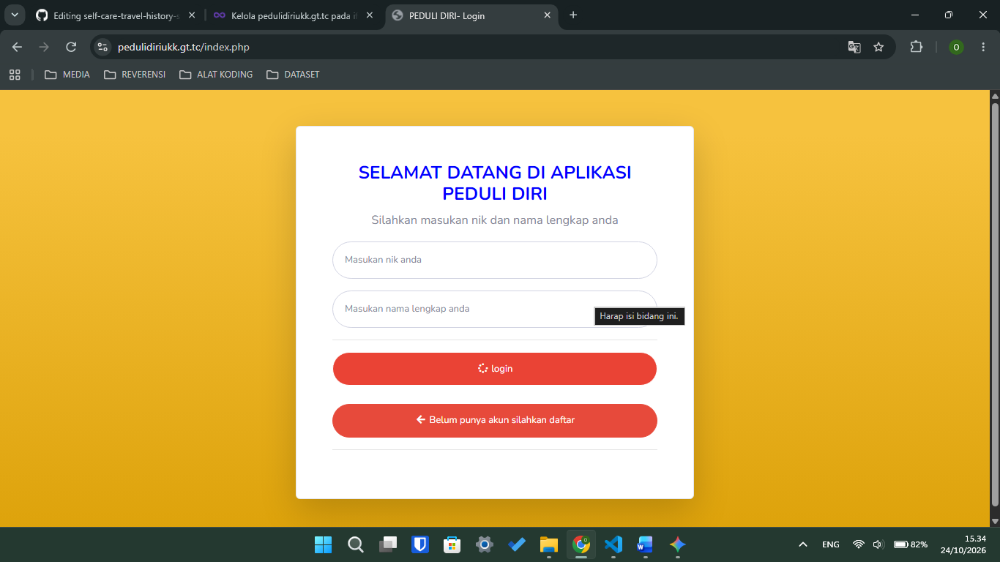
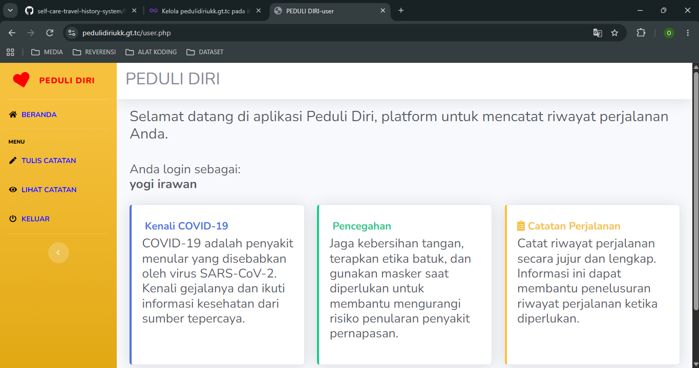
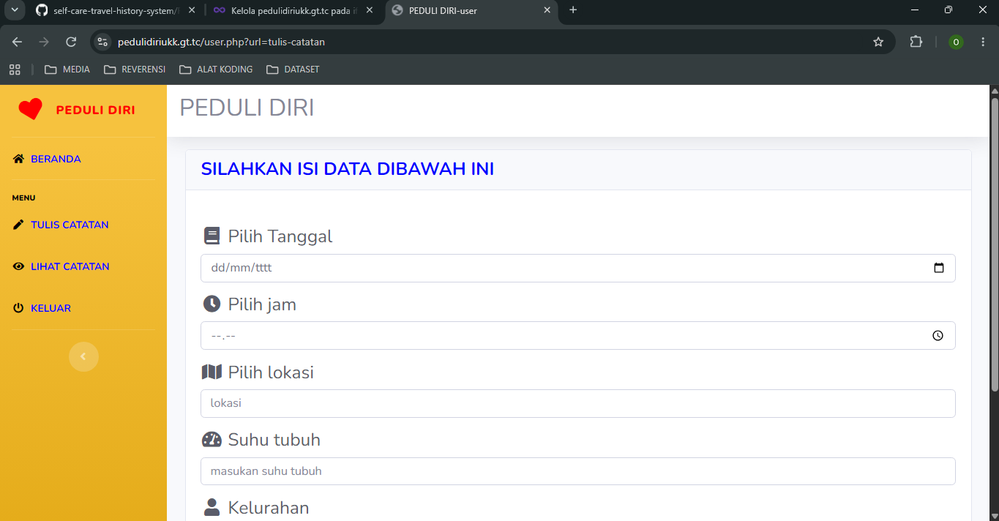
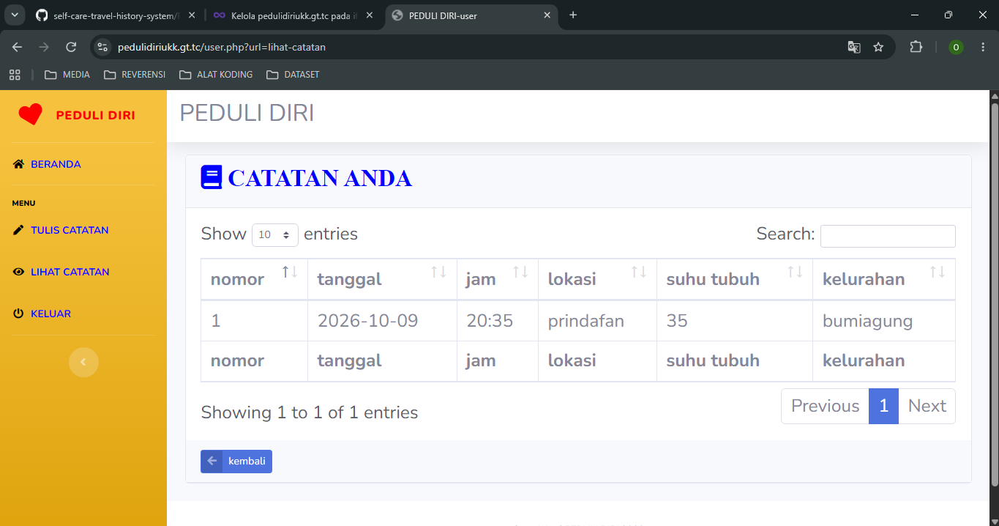

# 🦠 PEDULI DIRI - TRAVEL HISTORY

> A Web-Based Travel History Recording Information System for COVID-19 Prevention Using Native PHP, Bootstrap 5, and TXT Database.


🚀 **Live Demo Website:** [Try the Web Application Here](https://pedulidiriukk.gt.tc/index.php)

---

## 📖 Description

**Peduli Diri** is a web-based application designed to help users record and monitor their daily travel history as part of COVID-19 prevention and the mitigation of its spread.

The application allows users to record visited locations, dates, times, body temperatures, and village or urban ward information. All travel history records are stored in an organized manner using a text-based storage system (`.txt` files).

---

## ✨ Features

- 🔐 User Login & Registration (NIK and Full Name)
- 📊 Main Dashboard
- 📝 Travel Record Entry (Date, Time, Location, Body Temperature, and Village/Urban Ward)
- 📋 Travel History (Visit History Table)
- 🚪 User Logout

---

## 🚀 How the System Works

1. Users register using their NIK and full name or log in if they already have an account.
2. Users access the main Peduli Diri dashboard.
3. Users select the **Travel Record** menu to enter the date, time, location, body temperature, and village or urban ward information associated with a visit.
4. The system processes and saves the submitted records to text files (`.txt`) on the server.
5. Users can view their recorded travel history through the **Travel History** menu whenever needed.

---

## 🛠️ Technologies Used

### Frontend

- HTML5
- CSS3
- Bootstrap 5
- JavaScript
- Font Awesome Icons

### Backend

- Native PHP

### Database

- TXT (File-Based Storage)

### Development Tools

- Visual Studio Code
- XAMPP (Apache)
- Google Chrome

---

# 📂 Project Structure

```text
PEDULI_DIRI_UKK/
│
├── 📁 assets/
├── 📁 css/
├── 📁 js/
├── 📁 config/ (TXT file storage)
│
├── 📄 index.php
├── 📄 login.php
├── 📄 register.php
├── 📄 dashboard.php
├── 📄 user.php
├── 📄 tuls_catatan_perjalanan.php
├── 📄 simpan.php
└── 📄 README.md
```
---

# 🖼️ Application Preview

## 🔐 Login Page

> The authentication page allows users to log in to the system using their NIK and full name.



---

## 📊 Dashboard

> Displays summary information and the main navigation menu of the Peduli Diri application.



---

## 📝 Travel Record Entry

> An interface for recording daily travel history, including the date, time, location, body temperature, and village or urban ward.



---

## 📋 Travel History

> Displays all user travel history records stored on the server.



### Contact

📧 **Email**

yogiirawan490@gmail.com

💼 **LinkedIn**

https://www.linkedin.com/in/yogi-irawan-ab146a387

🐙 **GitHub**

https://github.com/ogikkoding

---

# 🤝 Contributing

Contributions are welcome!

If you discover bugs, have suggestions for improvements, or would like to contribute new features, please feel free to:

- Open an Issue
- Submit a Pull Request

---

# ⭐ Support

If you find this project useful, please consider giving it a ⭐ on GitHub.

Your support helps encourage future development and continuous improvement.

---

# 📄 License

This project is licensed under the **GNU General Public License v3.0 (GPL-3.0)**.
